# Comparative Experimental Report on Product Visual Anomaly Detection Methods based on MVTec AD

**实验时间**：2026 年 9 月
**实验环境**：Python 3.12 + PyTorch 2.14（CPU）
**数据集**：MVTec Anomaly Detection Dataset（15 类别）
**实验范围**：5 类别 × 2 方法（PatchCore / PaDiM）

---

## 一、项目概述

### 1.1 研究背景

工业制造中，产品表面缺陷检测是质量控制的核心环节。传统人工检测效率低、成本高，长时间作业下容易漏检。基于机器视觉的自动检测成为必然趋势，但深度学习方法在工业场景落地时面临一个根本性矛盾：

**缺陷样本无法穷举。** 监督学习要求每个类别都有充足标注样本，而产线上的缺陷类型不可预知——今天出现划痕，明天可能是污染，后天可能是从未见过的形变。更重要的是，异常样本本身稀少，收集几百张"某一种缺陷"的图在真实产线中往往不可行。

这催生了**开集异常检测**（Open-set Anomaly Detection）范式：仅使用正常样本建模，把"偏离正常模式"的样本判为异常。该方法不依赖任何缺陷先验，能够检测训练时从未出现过的缺陷类型。

### 1.2 项目目标

This project aims to build a complete product visual anomaly detection system，实现并对比两种当前主流的无监督异常检测方法：

1. **实现** PatchCore（CVPR 2022）与 PaDiM（ICPR 2021）两种 SOTA 方法
2. **评估** 在 MVTec AD 数据集上的检测与定位性能
3. **分析** 两种方法的优劣、失败模式与适用场景
4. **交付** 可复现的代码、完整实验数据与可视化结果

### 1.3 技术路线

整体流程分为四个阶段：（1）数据准备与探索；（2）特征提取与建模；（3）异常打分与定位；（4）评估与可视化。

两种方法共享**预训练特征 + 经典统计建模**的技术框架：使用 ImageNet 预训练的 Wide ResNet-50-2 提取多尺度特征（冻结权重，不微调），再分别用离散记忆库（PatchCore）和连续概率分布（PaDiM）描述正常模式。这一框架的关键优势在于**无需梯度训练**——建模过程实质是统计估计，单类别建模可在数分钟内完成。

---

## 二、数据集介绍

### 2.1 MVTec AD 数据集

MVTec AD（MVTec Anomaly Detection Dataset）由德国 MVTec Software GmbH 于 2019 年在 CVPR 发表，是工业异常检测领域使用最广泛的基准数据集。其核心特点是：

- **真实场景采集成像**：所有图像均来自真实工业产线，非合成数据
- **像素级精细标注**：每个异常样本都配有 ground truth 掩码，支持精确定位评估
- **类别多样性**：覆盖 15 种工业产品，涉及容器、电子元件、纺织品、金属零件、建材、食品等多个行业

### 2.2 数据统计

本项目使用的数据集共 15 个类别，统计如下：

| 统计项 | 数值 |
|--------|------|
| 产品类别 | 15 |
| 训练图像（正常） | 3,629 |
| 测试正常图像 | 467 |
| 测试异常图像 | 1,258 |
| 缺陷类型（去重） | 48 |
| 图像分辨率 | 900×900 ~ 1024×1024 |

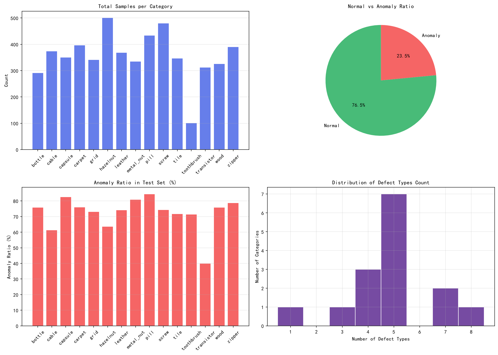
*图 2-1 数据集总览：样本总数、正常/异常比例与缺陷类型统计*

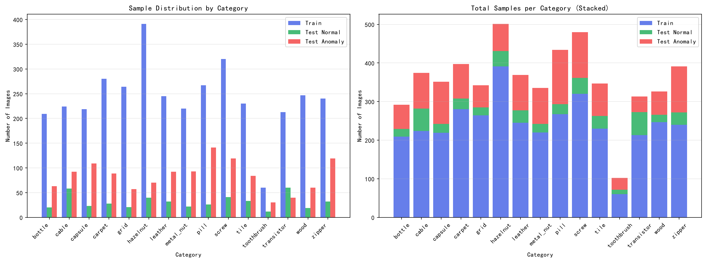
*图 2-2 各类别训练集、测试正常集与测试异常集的样本数量对比*

各类别详细分布存在明显不均衡：训练样本最多为 hazelnut（391 张）、最少为 toothbrush（60 张）；缺陷类型最多为 cable（8 种）、最少为 toothbrush（1 种）。这种不均衡本身就是工业场景的真实反映。

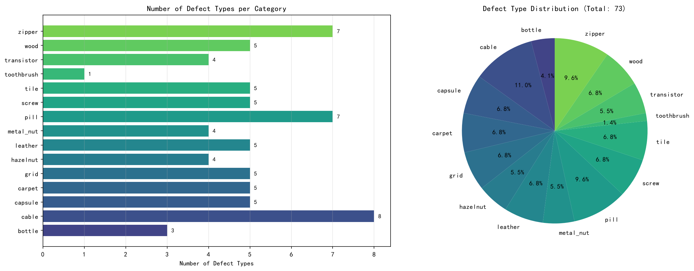
*图 2-3 各类别缺陷类型数量分布*

### 2.3 数据结构与命名规范

```
mvtec_anomaly_detection/
└── <category>/
    ├── train/good/                    # 正常训练样本（仅此目录参与建模）
    ├── test/good/                     # 正常测试样本
    ├── test/<defect_type>/            # 各缺陷类型的测试样本
    └── ground_truth/<defect_type>/    # 像素级标注掩码
```

命名规范统一：图像为 `<三位序号>.png`（如 `013.png`），对应掩码为 `<三位序号>_mask.png`（如 `013_mask.png`）。掩码为单通道灰度图，前景（缺陷区域）为白色（255），背景为黑色。

### 2.4 数据特点分析

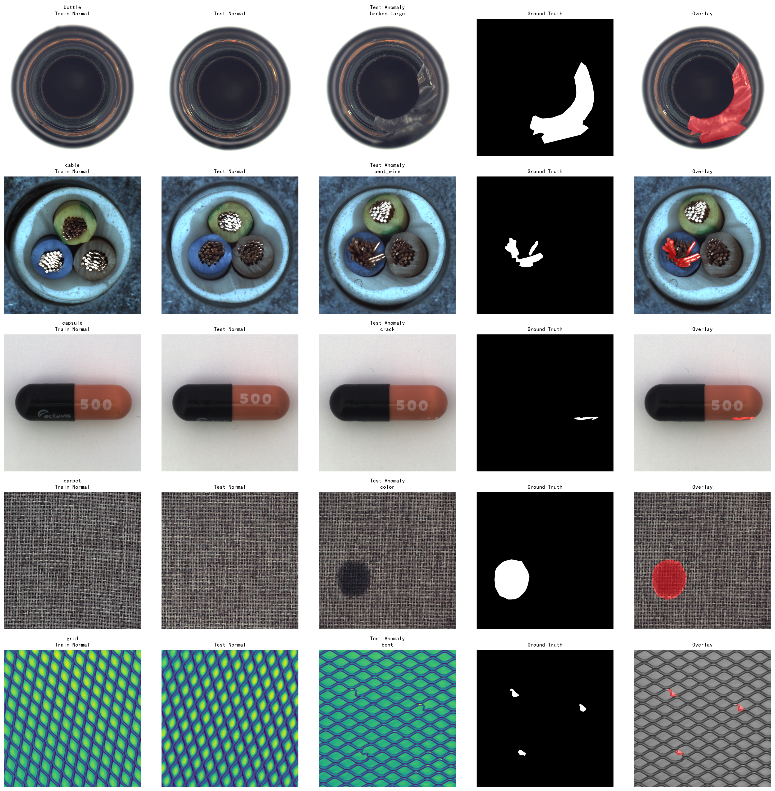
*图 2-4 正常样本与异常样本对比（含 GT 掩码及叠加效果）*

从可视化中可观察到数据集的三类难点：

1. **缺陷尺度差异极大**：从占图像不到 1% 的微小污染点到占 20% 以上的大面积破损，模型需要同时覆盖多个尺度
2. **缺陷形态多样**：包括划痕（scratch）、裂纹（crack）、污染（contamination）、形变（bent）、缺失（missing）等，有些缺陷与正常纹理的对比度很低
3. **正常样本本身存在变化**：如同一类产品因光照、纹理、位置带来的自然差异，模型必须区分"正常变化"与"真实缺陷"

### 2.5 数据清洗与预处理

本数据集**无需传统意义上的数据清洗**：数据由官方整理，命名规范统一，无缺失标签、无损坏文件、无重复样本。因此工作重点在于预处理而非清洗：

| 处理项 | 方案 | 说明 |
|--------|------|------|
| 尺寸统一 | Resize 至 224×224 | 原始图像分辨率不一致 |
| 归一化 | ImageNet 均值/标准差 | 与预训练权重匹配 |
| 掩码处理 | 最近邻插值 + 二值化 | 避免插值模糊缺陷边界 |
| 数据增强 | **不使用** | 记忆库/分布须忠实反映真实正常分布 |

关于数据增强需要特别说明：与图像分类任务不同，本类方法**不应对正常样本做翻转、旋转等增强**。原因是记忆库和高斯分布必须精确刻画真实正常样本的分布形态，强行增强会引入现实中不存在的样本模式，反而降低检测性能。官方实现同样仅做 resize 与归一化。

---

## 三、方法介绍

### 3.1 共同框架

两种方法都遵循"预训练特征 + 统计建模"的思路，属于**无监督学习（单类分类）**分支，由多层机器学习技术组合而成：

| 层面 | 技术归属 | 本项目体现 |
|------|----------|------------|
| 特征表示 | 监督学习 + 迁移学习 | WRN-50-2 在 ImageNet 上监督训练，本项目冻结复用 |
| 学习范式 | 无监督学习（单类分类） | 仅用正常样本建模 |
| 建模方法 | 密度估计 | 记忆库（非参数）/ 高斯分布（参数化） |
| 模型评估 | 机器学习评估方法论 | AUROC、AUPRO、F1-max |

### 3.2 PatchCore 原理

PatchCore 的核心思想是构建一个**正常特征记忆库**，用测试特征到记忆库的最近邻距离作为异常分数。

**（1）多尺度特征提取**：用预训练 WRN-50-2 提取 layer2（512 维）与 layer3（1024 维）特征，上采样对齐后拼接为 1536 维。选择中层而非最高层特征，是因为中层特征同时保留了语义信息与空间细节，更适合定位局部缺陷。

**（2）局部邻域聚合**：对特征做 3×3 平均池化，将邻域上下文融入每个 patch 位置，提升对局部形变的鲁棒性。

**（3）核心集采样**：全部正常样本的 patch 特征可达数十万条，全量保留会导致检索过慢且含大量冗余。采用贪心 k-center 策略选出最具代表性的 10%：每次选择"距离已选集合最远"的样本，从而保证对整个正常特征空间的均匀覆盖。为降低贪心采样的计算量，距离先在 128 维随机投影空间中计算。

**（4）异常打分与重加权**：测试 patch 在记忆库中检索 K=9 个最近邻。仅用最近邻距离会有一个问题——若记忆库中该处特征密集（正常样本本身多样），距离偏大也属正常。因此引入重加权：

$$s(f) = \left( 1 - \frac{e^{d(m^*, f)}}{\sum_{i} e^{d(m_i, f)}} \right) \cdot d(m^*, f)$$

其中 $m^*$ 为最近邻。直观理解：若 K 个近邻距离彼此接近，说明该区域特征密集、正常样本本就多样，则降低该分数的置信度；若存在一个明显更近的邻居，则保持高分。

**（5）异常图生成**：patch 分数双线性上采样至输入尺寸，再经高斯平滑得到热力图；图像级分数取热力图的最大值。

### 3.3 PaDiM 原理

PaDiM 的核心思想是为每个 patch 位置**单独建立多元高斯分布**，用马氏距离衡量偏离程度。

**（1）多尺度特征提取**：提取 layer1（256 维）+ layer2（512 维）+ layer3（1024 维）特征，拼接为 1792 维。相比 PatchCore 多用了 layer1，以保留更细粒度的纹理信息。

**（2）随机降维**：从 1792 维中随机选择 d 个维度。论文在 WRN50 上使用 d=550，本项目受 CPU 内存限制降至 d=100（3,136 个位置 × 100×100 协方差矩阵已是 CPU 可承受的上限）。

**（3）高斯分布建模**：对每个 patch 位置 $(i,j)$，用全部正常样本估计均值 $\mu_{ij}$ 与协方差 $\Sigma_{ij}$（加 $\varepsilon I$ 正则化保证可逆）。协方差矩阵记录了特征维度间的相关性，这是比"逐维方差"更精确的关键。

**（4）马氏距离**：测试特征 $x_{ij}$ 的异常分数为：

$$d(x_{ij}) = \sqrt{\, (x_{ij} - \mu_{ij})^{\top} \, \Sigma_{ij}^{-1} \, (x_{ij} - \mu_{ij}) \,}$$

马氏距离等价于"按正常样本分布形状归一化后的距离"：在高方差方向上偏离会被弱化，在低方差方向上偏离会被放大。

### 3.4 方法对比

| 维度 | PatchCore | PaDiM |
|------|-----------|-------|
| 正常模式表示 | 离散记忆库（4,000 个代表性 patch） | 连续高斯分布（3,136 个） |
| 异常度量 | KNN 距离 + 近邻密度重加权 | 马氏距离（利用特征相关性） |
| 特征层 | layer2 + layer3 | layer1 ~ layer3 |
| 主要误差来源 | 核心集采样的覆盖度 | 降维带来的信息损失 |
| 建模复杂度 | O(N·M)（贪心采样较慢） | O(N·P·d²)（协方差估计） |

---

## 四、实验设置

### 4.1 硬件与软件环境

| 项目 | 配置 |
|------|------|
| CPU | AMD Radeon 集显平台（无独立 NVIDIA GPU） |
| PyTorch | 2.14.0+cpu |
| 特征骨干 | torchvision 官方 Wide ResNet-50-2（ImageNet-1K 预训练） |
| 主要依赖 | numpy / scipy / scikit-learn / matplotlib / opencv |

全部实验在 CPU 环境下完成，5 类别 × 2 模型的批量实验总耗时约 21 分钟。

### 4.2 实验参数

| 参数 | PatchCore | PaDiM |
|------|-----------|-------|
| 输入尺寸 | 224×224 | 224×224 |
| 特征层 | layer2 + layer3 | layer1 + layer2 + layer3 |
| 特征维度 | 1,536 | 1,792 → 100（随机降维） |
| 核心超参数 | coreset_ratio=0.1, K=9 | ε=0.01 |
| 记忆库/分布规模 | 4,000 patch 特征 | 3,136 个高斯分布 |
| 随机投影维度 | 128 | — |
| 高斯平滑 σ | 4.0 | 4.0 |
| 随机种子 | 42 | 42 |

实验类别选取 bottle、cable、carpet、hazelnut、transistor 五类，覆盖透明容器、细线缆结构、纹理表面、自然物体、电子元件五种典型场景。

### 4.3 评估指标

评估遵循 MVTec AD 论文的标准协议，从**图像级判别**（能否发现异常图）与**像素/区域级定位**（异常在哪）两个层面、共四个指标衡量。评估设计围绕三个核心问题展开：**判别粒度**（发现 vs 定位）、**阈值依赖**（排序能力 vs 部署决策）、**公平性**（小缺陷不被大缺陷掩盖、低误报区间被重点考察）。

#### 4.3.1 Image AUROC（图像级 · 阈值无关）

把每张测试图作为一个样本，用图像级异常分数做二分类，计算 ROC 曲线下面积：

$$\mathrm{AUROC} = \int_{0}^{1} \mathrm{TPR} \, d(\mathrm{FPR})$$

- **TPR** = TP / (TP + FN)：异常图被正确识别的比例（召回率；TP 为异常图判对，FN 为漏检）
- **FPR** = FP / (FP + TN)：正常图被误判为异常的比例（误报率）
- **等价理解**：随机取一张异常图和一张正常图，异常图分数更高的概率——0.5 相当于随机猜测，1.0 为完美排序
- **阈值无关**：衡量异常分数的排序能力，不需要预设判定阈值。这是四项指标中最重要的一项，直接回答"能否拦住异常品"

#### 4.3.2 Pixel AUROC（像素级 · 阈值无关）

把异常图的每个像素作为一个样本，与 Ground Truth 掩码逐像素比较，汇总所有测试图的像素后计算——**公式与 Image AUROC 完全相同，只是统计单元从「图」变为「像素」**：

$$\mathrm{AUROC}_{\mathrm{pixel}} = \int_{0}^{1} \mathrm{TPR} \, d(\mathrm{FPR})$$

- 衡量异常热力图能否准确指出缺陷所在的像素位置
- **注意大缺陷偏置**：按像素统计时，大缺陷贡献的像素多、权重高，小而关键的缺陷漏检容易被掩盖（由 AUPRO 补正）

#### 4.3.3 AUPRO（区域级 · 阈值无关）

先对每个缺陷连通域计算重叠率，再对所有区域取平均，最后在低误报区间上积分：

$$\begin{aligned}
O_R(t) &= \frac{|\{\, p \in R : s(p) \geq t \,\}|}{|R|} \\
\mathrm{PRO}(t) &= \frac{1}{N} \sum_{R} O_R(t) \\
\mathrm{AUPRO} &= \frac{1}{0.3} \int_{0}^{0.3} \mathrm{PRO} \, d(\mathrm{FPR})
\end{aligned}$$

- **$O_R(t)$**：阈值 $t$ 下，缺陷连通域 $R$ 中被检出的像素比例（Per-Region Overlap）
- **PRO**：所有缺陷区域重叠率的平均——每个区域权重相同，与缺陷大小无关
- **FPR ≤ 0.3**：工业场景对误报容忍度低，评估聚焦低误报区间；积分后按区间长度归一化

**为什么需要 AUPRO？** Pixel AUROC 按像素统计时，大缺陷贡献的像素多、权重高，小缺陷的漏检容易被掩盖。而工业检测中每个缺陷都重要，不论大小。AUPRO 先按缺陷连通域计算重叠率再平均，使每个缺陷区域权重相同，能更公平地反映区域级检出质量。

#### 4.3.4 F1-max（图像级 · 最优阈值）

遍历所有判定阈值，取精确率与召回率调和平均的最大值：

$$\begin{aligned}
P &= \frac{TP}{TP + FP}, \qquad R = \frac{TP}{TP + FN} \\
F_1 &= \frac{2PR}{P + R}, \qquad F_1\text{-max} = \max_{t} F_1(t)
\end{aligned}$$

- **P（精确率）**：判为异常的图中真正异常的比例——误报越少越高
- **R（召回率）**：异常图中被检出的比例——漏检越少越高
- 回答的问题是「部署到产线后，最优阈值下能达到什么实际判别水平」——与 AUROC 评估的排序能力互补。此外，本项目用 F1 最优阈值作为判定阈值开展失败案例分析（见 6.2 节）

#### 4.3.5 指标参考区间（优良判断）

各指标的「优良」参考区间如下（综合 MVTec AD 论文水平与工业实践经验）：

| 指标 | 优秀 | 良好 | 可用 | 偏弱 |
|------|------|------|------|------|
| Image AUROC | ≥ 99% | 97 ~ 99% | 95 ~ 97% | < 95% |
| Pixel AUROC | ≥ 98% | 96 ~ 98% | 93 ~ 96% | < 93% |
| AUPRO | ≥ 95% | 90 ~ 95% | 85 ~ 90% | < 85% |
| F1-max | ≥ 98% | 95 ~ 98% | 90 ~ 95% | < 90% |

**参照系（帮助理解数值含义）：**

| 参照点 | Image AUROC | 说明 |
|--------|-------------|------|
| 随机猜测 | 50% | 完全无判别能力 |
| 传统方法（自编码器等） | 85 ~ 95% | 早期基线水平 |
| PaDiM（论文） | 约 97.5% | 2021 年 SOTA |
| PatchCore（论文） | 约 99.6% | 2022 年 SOTA |

> **注**：AUPRO 数值受实现口径影响（FPR 上界、平滑参数等），优良判断应以同一实现下的横向对比为主，论文数值仅作量级参考。

**优良判断原则：**

1. **看优先级**：先看 Image AUROC（能否用）→ 再看 AUPRO（定位是否可信）→ 最后 F1-max（部署工作点）
2. **看最弱类别**：均值再高，单个类别偏低就是产线上的漏洞，需单独分析
3. **看场景要求**：业务指标优先于学术指标——若产线要求漏检率低于 0.1%，则「95% 良好」也可能不达标
4. **横向对比优先**：同一数据集、同一实现口径下比较，比绝对数值更有参考意义

经验法则（图像级）：90% 是"能用"线 → 95% 是"好用"线 → 99% 是"顶尖"线。

---

## 五、实验结果

### 5.1 定量结果

**表 5-1 总体结果（5 类别平均）**

| 模型 | Image AUROC | Pixel AUROC | AUPRO | F1-max | 平均建模耗时 |
|------|-------------|-------------|-------|--------|-------------|
| **PatchCore** | **0.9976** | **0.9845** | **0.9778** | **0.9889** | 131 s |
| PaDiM | 0.9520 | 0.9739 | 0.9411 | 0.9288 | 47 s |

**表 5-2 各类别明细**

| 模型 | 类别 | Image AUROC | Pixel AUROC | AUPRO | F1-max |
|------|------|-------------|-------------|-------|--------|
| PatchCore | bottle | 1.0000 | 0.9853 | 0.9982 | 1.0000 |
| PatchCore | cable | 0.9912 | 0.9856 | 0.9826 | 0.9681 |
| PatchCore | carpet | 0.9976 | 0.9900 | 0.9894 | 0.9888 |
| PatchCore | hazelnut | 1.0000 | 0.9869 | 0.9328 | 1.0000 |
| PatchCore | transistor | 0.9992 | 0.9744 | 0.9857 | 0.9877 |
| PaDiM | bottle | 1.0000 | 0.9832 | 0.9959 | 1.0000 |
| PaDiM | cable | 0.8606 | 0.9522 | 0.8987 | 0.8286 |
| PaDiM | carpet | 0.9952 | 0.9830 | 0.9766 | 0.9944 |
| PaDiM | hazelnut | 0.9550 | 0.9761 | 0.8680 | 0.9504 |
| PaDiM | transistor | 0.9492 | 0.9749 | 0.9664 | 0.8706 |

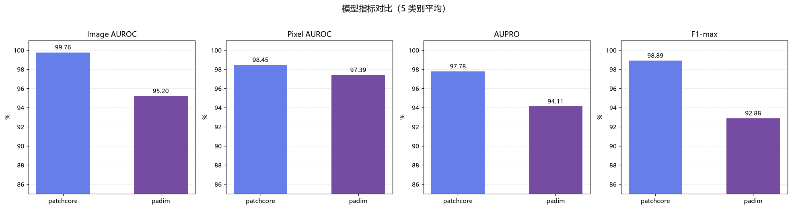
*图 5-1 两模型在四项指标上的平均表现对比*

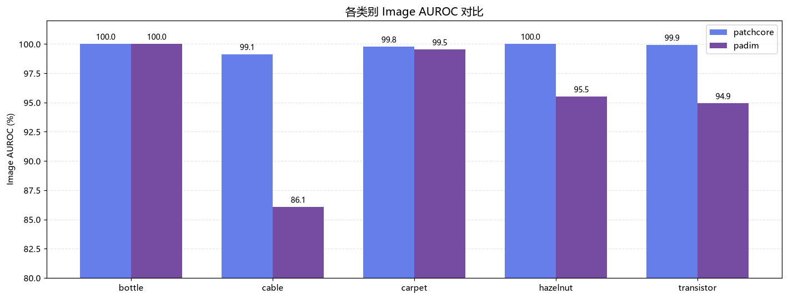
*图 5-2 各类别 Image AUROC 分组对比*

### 5.2 定性结果

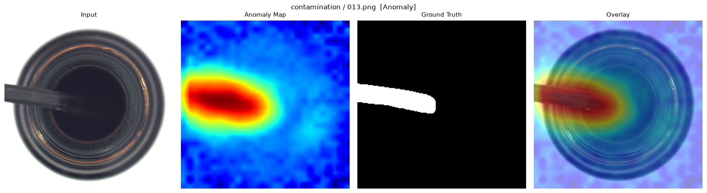
*图 5-3 PatchCore 在 bottle 上的检测结果：热力图精准覆盖瓶口污染区域*

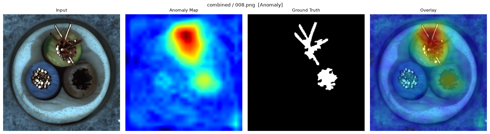
*图 5-4 PatchCore 在 cable 上的检测结果：正确检出电缆组件的破损与缺失区域*

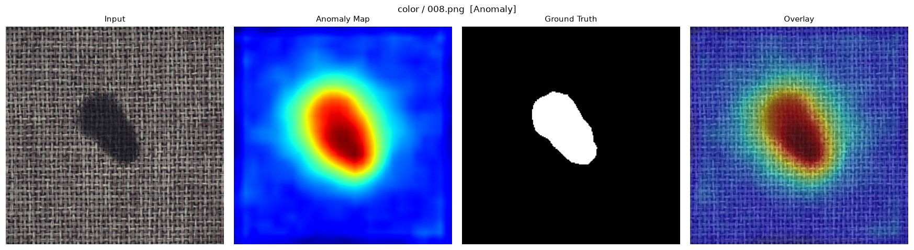
*图 5-5 PatchCore 在 carpet 上的检测结果：纹理表面的缺陷定位*

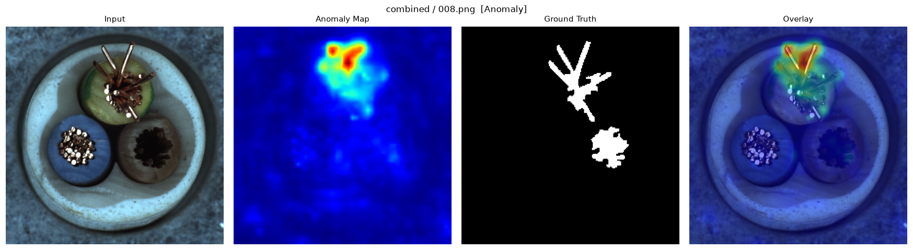
*图 5-6 PaDiM 在 cable 上的检测结果：可见多处缺陷未被热力图覆盖（漏检）*

### 5.3 方法对比总结

| 对比维度 | PatchCore | PaDiM | 结论 |
|----------|-----------|-------|------|
| Image AUROC | 0.9976 | 0.9520 | PatchCore 领先 4.6 个百分点 |
| Pixel AUROC | 0.9845 | 0.9739 | 差距仅 1.1 个百分点 |
| AUPRO | 0.9778 | 0.9411 | PatchCore 区域检出更完整 |
| F1-max | 0.9889 | 0.9288 | PatchCore 判别能力更均衡 |
| 最弱类别 | cable (0.9912) | cable (0.8606) | 细线缆均为难点 |
| 建模速度 | 131 s | 47 s | PaDiM 快约 3 倍 |

---

## 六、分析与讨论

### 6.1 性能差异的成因分析

**PatchCore 全面领先的原因**在于其记忆库机制对特征空间的覆盖更充分：

1. **无信息损失**：记忆库直接存储真实正常特征，核心集采样只是"选代表"而非"压缩信息"；相比之下 PaDiM 的随机降维（1792 → 100 维）丢失了约 94% 的特征维度信息
2. **协方差估计的样本量约束**：PaDiM 要为每个 patch 位置估计 100×100 的协方差矩阵，而部分类别训练样本仅 200 余张，样本量相对维度偏少，协方差估计不稳定
3. **重加权机制的价值**：PatchCore 的近邻密度重加权有效抑制了"正常样本多样"导致的虚高分数

**PaDiM 的短板集中体现在 cable 类别**（Image AUROC 仅 0.8606）。cable 的缺陷形态是细线缆结构上的微小破损与缺失，特征区分度低，对特征维度的要求高。本项目受 CPU 内存限制将维度从论文的 550 降至 100，信息损失在此类任务上被放大。**预计恢复论文的 550 维后，PaDiM 在 cable 上的表现会有明显提升。**

### 6.2 失败案例分析

利用 F1 最优阈值对全部测试样本做判定，统计结果如下：

**表 6-1 失败案例统计（F1 最优阈值下）**

| 模型 | 误检（正常判异常） | 误检率 | 漏检（异常未检出） | 漏检率 |
|------|-------------------|--------|-------------------|--------|
| PatchCore | 7 / 206 | 3.4% | 7 / 354 | 2.0% |
| PaDiM | 44 / 206 | 21.4% | 16 / 354 | 4.5% |

这组数据揭示了一个关键差异：**PaDiM 的主要问题不是"找不到缺陷"，而是"误报太多"**——误检率高达 21.4%，是 PatchCore 的 6 倍。这与其 Pixel AUROC 尚可（0.9739）但 Image AUROC 偏低（0.9520）的现象一致：像素级定位能力尚可，但图像级判别被大量误报拖累。

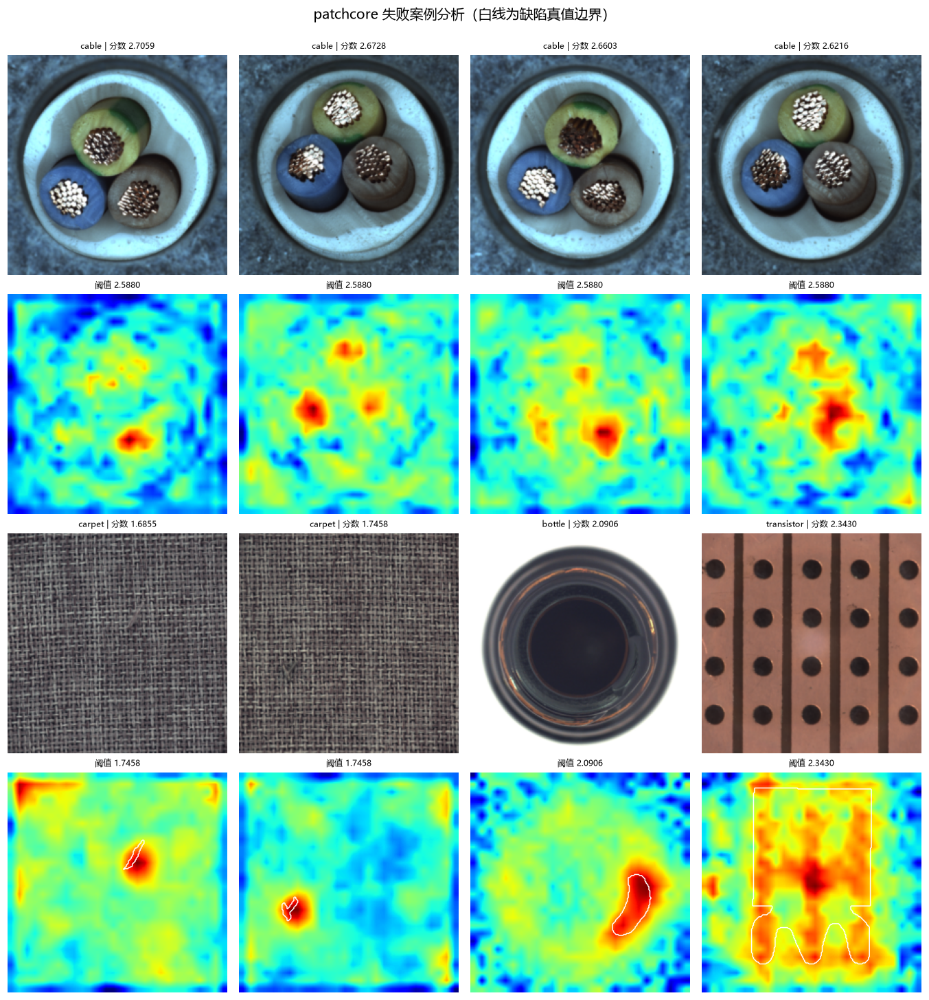
*图 6-1 PatchCore 失败案例分析（上：误检，下：漏检；白线为缺陷真值边界）*

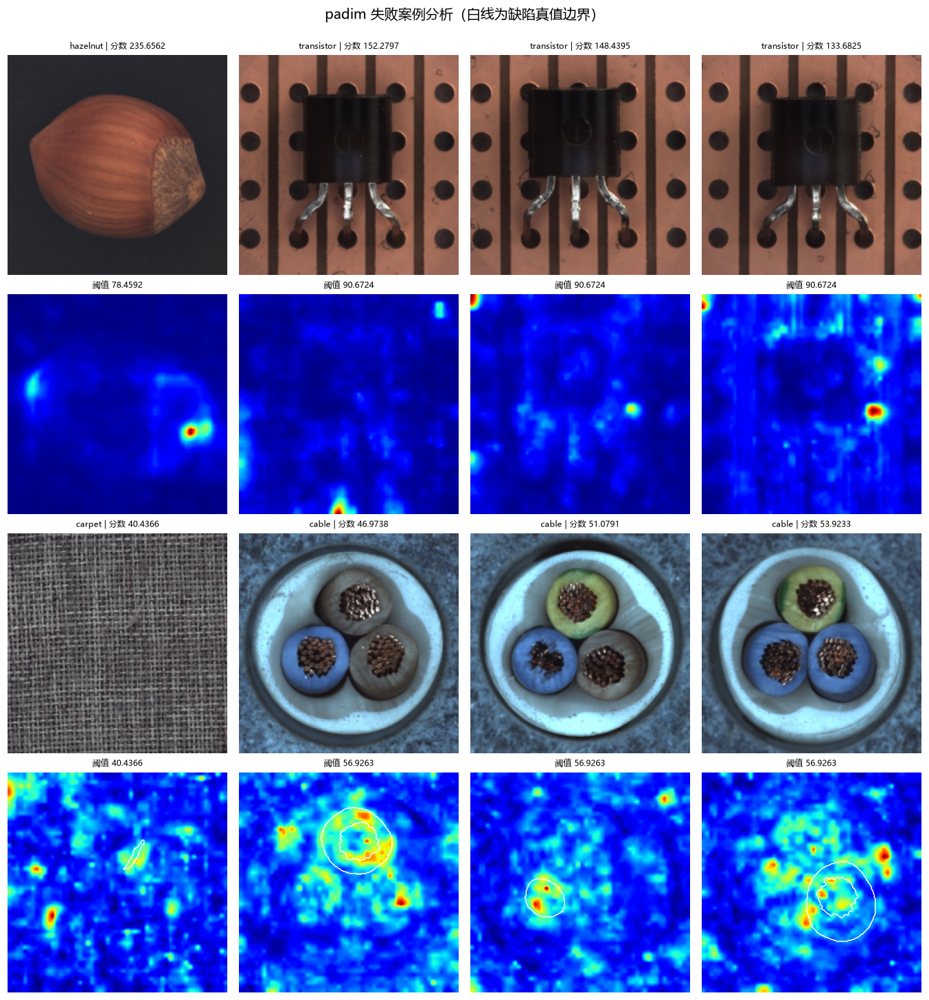
*图 6-2 PaDiM 失败案例分析：误检案例集中在 hazelnut / transistor，漏检案例集中在 cable / carpet*

**误检的典型模式**：观察图 6-2 上半部分，PaDiM 的误检案例中热力图高亮往往出现在图像边缘、背景区域或物体轮廓处。原因是这些区域的特征方差估计不稳定，导致正常波动被放大为高马氏距离。

**漏检的典型模式**：图 6-2 下半部分的 cable / carpet 案例中，热力图在缺陷位置（白色轮廓内）没有明显响应。carpet 的缺陷是纹理级别的细微变化，与正常纹理的统计差异小，现有特征的分辨能力不足。

**两个模型的共同难点**：hazelnut 的 AUPRO（PatchCore 0.9328 / PaDiM 0.8680）明显低于其 Image AUROC。这说明异常图能被检出，但缺陷区域的定位不够完整——可能只覆盖了缺陷的一部分。这与榛子表面缺陷边界模糊、GT 标注本身存在主观性有关。

### 6.3 效率分析

| 阶段 | PatchCore | PaDiM |
|------|-----------|-------|
| 建模（单类别） | 125 ~ 150 s | 38 ~ 64 s |
| 推理（单类别测试集） | 24 ~ 41 s | 18 ~ 31 s |
| 记忆库/分布规模 | 4,000 × 1,536 维 | 3,136 × 100×100 协方差 |
| 模型存储 | 约 5.6 MB（scores.npz） | 约 6.8 MB |

（存储为异常图与分数的压缩包，非模型权重本身；实际 PaDiM 的协方差矩阵存储开销更大。）

PatchCore 的建模耗时主要消耗在核心集采样（贪心策略的 4,000 次迭代），PaDiM 的耗时集中在协方差矩阵求逆。在 CPU 环境下两者都可接受，若使用 GPU 且启用批量并行，耗时还能显著降低。

### 6.4 改进方向

基于上述分析，可以从四个方向改进：

1. **恢复 PaDiM 的论文配置**：将特征维度从 100 恢复到 550，并增加训练样本的利用效率（如分块估计协方差），预期能显著改善 cable 类别的表现
2. **降低误检率**：针对 PaDiM 高误检问题，可引入更强的正则化（增大 ε）或对图像级分数采用分位数统计（如取 top-1% 分位数的均值）替代最大值
3. **提升小缺陷检测**：引入更高分辨率的输入（如 512×512）或使用多尺度特征金字塔，改善 carpet 等纹理类别的细微缺陷检出
4. **扩展评估范围**：当前仅评估 5 个类别，扩展到全部 15 类能更全面地检验方法泛化性

---

## 七、总结与展望

### 7.1 主要结论

1. **PatchCore 是本项目的最优方案**：四项指标均达优秀档（Image AUROC 0.9976、Pixel AUROC 0.9845、AUPRO 0.9778、F1-max 0.9889），与论文报告水平（约 0.996）一致，验证了实现正确性
2. **PaDiM 在简单场景下可用**：在 bottle、carpet 等类别上表现良好，且建模速度是 PatchCore 的约 3 倍，适合对训练时间敏感、缺陷结构简单的场景
3. **两者的核心差异在误检率而非漏检率**：PaDiM 误检率 21.4%，PatchCore 仅 3.4%。这说明 PaDiM 的瓶颈在于"正常样本的多样性建模不足"，而非"缺陷检出能力弱"
4. **细结构类别是共同难点**：cable 对两种方法都最具挑战性，反映了当前基于预训练 CNN 特征的方法在细粒度结构缺陷上的局限
5. **CPU 环境完全可行**：在无 GPU 条件下完成全部实验，具备实际落地参考价值

### 7.2 方法适用建议

| 场景 | 推荐方法 | 理由 |
|------|----------|------|
| 追求最高检测精度 | PatchCore | 四项指标全面领先 |
| 缺陷结构简单、需快速部署 | PaDiM | 建模快 3 倍，性能可接受 |
| 细线缆/精密结构 | PatchCore | PaDiM 在此类显著退化 |
| 内存受限环境 | PaDiM | 分布参数比记忆库更紧凑 |

### 7.3 未来展望

从技术演进角度看，工业异常检测正在经历两个转变：

**从手工特征到预训练表示**：本项目的实践证明，ImageNet 预训练的通用特征在工业场景具有很强的迁移能力。当前研究前沿已开始使用 DINOv2、CLIP 等更强的视觉基础模型，预期能进一步提升细结构缺陷的检出能力。

**从单一方法到多方法融合**：PatchCore 在图像级判别上的优势与 PaDiM 在速度上的优势可以互补，通过集成或级联（快速筛选 + 精细复核）有望在精度与效率之间取得更好平衡。

从工程落地角度看，本项目验证的"仅用正常样本建模"范式具有很高的实用价值——产线上只需采集一批正常产品图像即可部署检测能力，显著降低了传统监督方案的标注成本与维护难度。

---

## 八、参考文献

1. Bergmann, P., Fauser, M., Sattlegger, D., & Steger, C. (2019). **MVTec AD — A Comprehensive Real-World Dataset for Unsupervised Anomaly Detection**. *IEEE Conference on Computer Vision and Pattern Recognition (CVPR)*, 9592–9600.

2. Roth, K., Pemula, L., Zepeda, J., Schölkopf, B., Brox, T., & Gehler, P. (2022). **Towards Total Recall in Industrial Anomaly Detection**. *CVPR 2022*, 14298–14308. (PatchCore)

3. Defard, T., Setkov, A., Loesch, A., & Audigier, R. (2021). **PaDiM: a Patch Distribution Modeling Framework for Anomaly Detection and Localization**. *International Conference on Pattern Recognition (ICPR)*, 475–489.

4. Bergmann, P., Fauser, M., Sattlegger, D., & Steger, C. (2020). **Uninformed Students: Student-Teacher Anomaly Detection with Discriminative Latent Embeddings**. *CVPR 2020*, 4183–4192. (STFPM)

5. Yu, J., Zheng, Y., Wang, X., Li, W., Wu, Y., Zhao, R., & Wu, L. (2021). **FastFlow: Unsupervised Anomaly Detection and Localization via 2D Normalizing Flows**. *WACV 2022*, 3835–3844.

6. He, K., Zhang, X., Ren, S., & Sun, J. (2016). **Deep Residual Learning for Image Recognition**. *CVPR 2016*, 770–778. (ResNet 骨干网络)

7. Liu, W., et al. (2025). **MVTec AD 2: A New Benchmark for Anomaly Detection**. MVTec Software GmbH.

---

## 附录：复现命令

```bash
# 环境准备
pip install -r requirements.txt

# 数据准备（解压至 data/raw/mvtec_anomaly_detection/）

# 数据探索
python scripts/explore_dataset.py
python scripts/visualize_dataset.py

# 批量实验（5 类别 × 2 模型，约 21 分钟）
python scripts/run_all.py

# 结果分析与失败案例
python scripts/analyze_results.py
```

---

*报告完*
